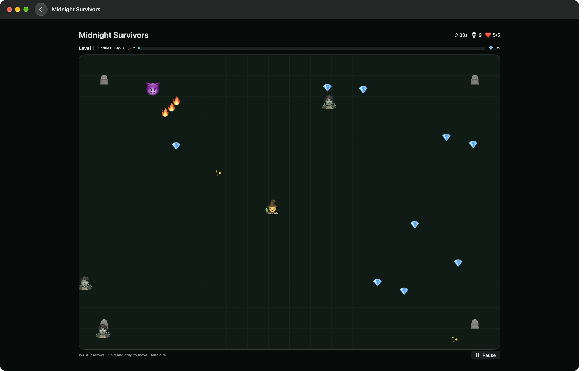

# SwiftECS

A type-safe, archetype-based Entity Component System for Swift 6, with strict concurrency and parallel systems.



## Features

- Archetype storage with cached, typed queries built on parameter packs
- Composable query predicates (`&&`, `||`, `!`), including relationship-based queries
- Systems with phases, pipelines, dependencies, and deferred commands
- Opt-in parallel systems, checked for data races at compile time
- Entity relationships with hierarchies, cycle checks, and recursive deletion
- Component, destroy, and relationship observers that report old and new values
- SwiftUI Observation support, with batched notifications
- Stable typed component references for hot loops

## Requirements

The package requires Swift 6.2 or later. Declared Apple deployment targets are macOS, iOS, and visionOS 26 or later.

## Installation

```swift
.package(url: "https://github.com/schwa/SwiftECS", from: "0.1.0")
```

## Usage

Components are plain structs. Entities hold components. Systems query entities and update them each frame.

```swift
import SwiftECS

// A component is a plain struct.
struct Position: Component { var x, y: Double }
struct Velocity: Component { var x, y: Double }

// Make a world and add one entity with two components.
let world = World()
world.createEntity(Position(x: 0, y: 0), Velocity(x: 1, y: 0))

// Add a system that moves each entity that has both components.
try world.addSystem(System("movement")
    .query(Write<Position>(), Read<Velocity>())
    .each { context, position, velocity in
        position.value.x += velocity.x * context.deltaTime
    })

// Run all systems for one frame.
try world.update(deltaTime: 1.0 / 60)
```

See the [documentation](https://schwa.github.io/SwiftECS/documentation/swiftecs/) for queries, systems, parallel execution, relationships, and observation.

## License

MIT, see [LICENSE](LICENSE).
